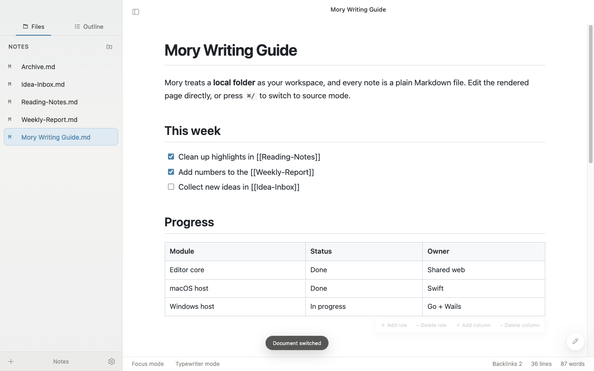
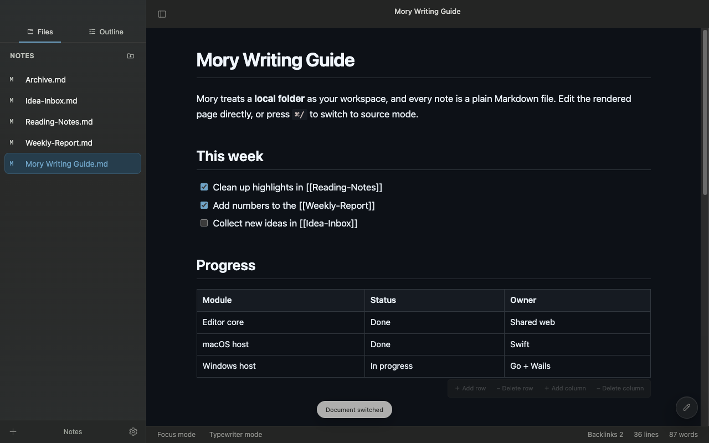
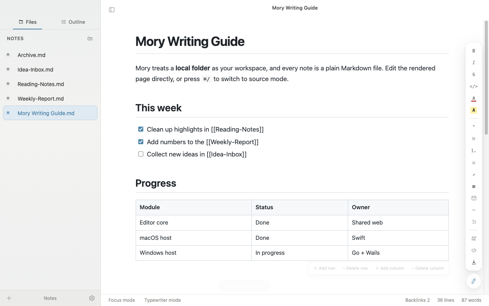
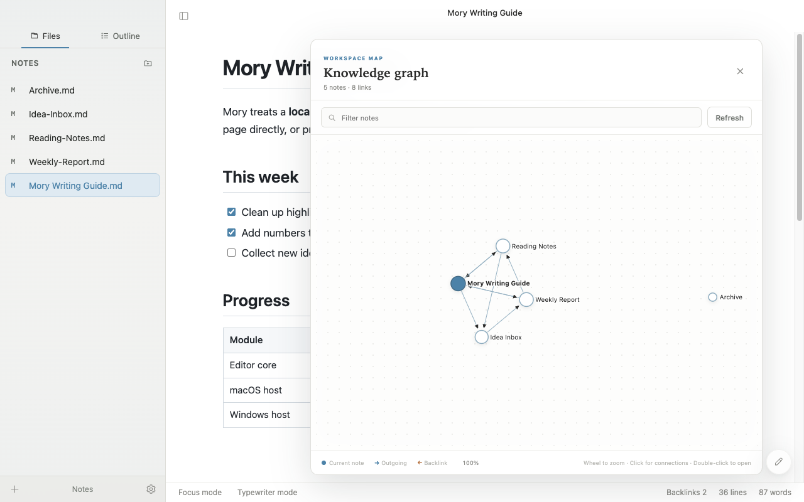

<p align="center">
  
</p>

<h1 align="center">Mory</h1>

<p align="center">
  A local-first, cross-platform Markdown editor for macOS and Windows<br>
  <a href="README.md">简体中文</a> · <strong>English</strong>
</p>



Mory is a Markdown editor for macOS and Windows. Native desktop hosts share one web-based editing core, so you get a WYSIWYG writing experience while your notes stay plain Markdown files. A workspace is an ordinary folder on disk; there is no proprietary database.

## Contents

- [Name](#name)
- [Features](#features)
- [Screenshots](#screenshots)
- [Architecture](#architecture)
- [Tech stack](#tech-stack)
- [Getting started](#getting-started)
- [Build and package](#build-and-package)
- [Startup and workspaces](#startup-and-workspaces)
- [Command line](#command-line)
- [Testing](#testing)
- [Repository layout](#repository-layout)

## Name

`Mory` combines `M` and `ory`. `M` stands for Markdown and Memory, and `ory` comes from Story. The name reflects the product goal: record content in Markdown and organize scattered documents into searchable, linkable, durable personal memories and stories.

The official project name is `Mory`. Application names, package names, and release artifacts use this spelling.

## Features

**Writing**

- WYSIWYG editing of rendered Markdown; press `⌘/` to switch to source mode.
- Full Markdown: headings, lists, task lists, tables, quotes, links, images, and horizontal rules.
- Code blocks highlighted by highlight.js, with folding for long blocks; headings can be folded too.
- Live Mermaid rendering for flowcharts, sequence diagrams, and more, with a dedicated Mermaid editing panel.
- Calendar blocks for interactive schedules and time ranges inside a document.
- One-click typography: pangu.js inserts spacing between CJK and Latin text while preserving code and HTML attributes.
- Text and background colors, find and replace, focus mode, typewriter mode, and interface zoom.
- Floating formatting toolbar in the lower-right corner: collapsed into a single button by default and expanded on hover, so it never covers the writing area. Click the button to pin it open; press `Esc` to close it.

**Workspaces and knowledge**

- Any local folder can be a workspace, with a nested file tree and create, rename, duplicate, move, and delete (to Trash) operations.
- Images live with their documents: pasted or dropped images are stored in a folder named after the document, and paths are migrated automatically on rename and Save As.
- Bidirectional links: `[[wiki links]]` and relative Markdown links, with backlinks shown below each document.
- Knowledge graph: a D3 force-directed view of links between documents, with filtering, zooming, and double-click to open.
- Quick Open, recent documents and workspaces, and crash recovery for unsaved content.
- Live sync with external changes: editing files in another editor or through Git refreshes the file tree automatically.
- Optional remote storage plugins for S3, Aliyun OSS, GitHub, and SFTP. Local workspaces always remain the default.

**Themes and export**

- Eight built-in document themes (GitHub, Lapis CV, Yuluo CSS, Whitey, Newsprint, Pixyll, Gothic, Night), plus custom CSS theme import.
- Light, dark, and system appearances, with frosted-glass floating surfaces.
- Export to HTML, PDF, PNG, and JPEG, and to PowerPoint through Slidev. Exports use the same themed rendering as the editor.
- Switch the interface between Simplified Chinese and English instantly in Preferences.

## Screenshots

| Light | Dark |
| --- | --- |
|  |  |

| Floating formatting toolbar | Knowledge graph |
| --- | --- |
|  |  |

The screenshots are generated by `npx electron scripts/readme-screenshots/capture.cjs`, which renders the real interface with sample documents. Run it again after UI changes to refresh them.

## Architecture

```text
┌───────────────────────────────────────────────────────────────┐
│                    Shared web editing core                    │
│  app.js (UI and state)     markdown.js (parse and serialize)  │
│  editor-features.js (aids) knowledge.js (links and graph)     │
│        ↓ bundled into app.bundle.js by scripts/build-web.mjs  │
└───────────────┬──────────────────┬──────────────────┬─────────┘
                │   hostRequest / callbacks (JSON)    │
┌───────────────▼───┐  ┌───────────▼────────┐  ┌──────▼─────────────┐
│ macOS native host │  │ Windows host       │  │ Electron host      │
│ Swift + AppKit    │  │ Go + Wails         │  │ Node.js            │
│ WKWebView         │  │ WebView2           │  │ Chromium           │
│ FSEvents watcher  │  │ signature polling  │  │ fs.watch + polling │
└─────────┬─────────┘  └─────────┬──────────┘  └─────────┬──────────┘
          └──────────────┬───────┴───────────────────────┘
                         ▼
     Local folder (Markdown + image folders) / mory-storage remote sync plugin
```

**Shared editing core.** All three hosts load the same `Sources/Mory/Web` directory. The editor is a `contenteditable` element: `markdown.js` converts Markdown to HTML for display and serializes the edited DOM back to Markdown, so files on disk remain readable plain text. Rendered HTML is sanitized by DOMPurify, code blocks are highlighted by highlight.js, and Mermaid diagrams render asynchronously. Source mode edits the Markdown text directly, and both modes share one undo history.

**Host bridge.** The web core never touches the file system directly. It sends JSON requests through `hostRequest(method, args)`, such as `workspaceDocuments`, `renameWorkspaceEntry`, or `importImage`. The host performs the operation and replies through `window.Mory.resolveHostRequest`. Hosts also push state, for example `window.Mory.setWorkspaceSnapshot` (the file tree), `openDocument`, and `didSave`. Every host implements the same contract, so editing behavior stays consistent across platforms.

**Workspace scanning and watching.** When a local folder opens, the host walks it once to build the document and directory lists, and recognizes per-document image folders so they can be hidden from the tree. To stay responsive in large workspaces:

- macOS scans on a background serial queue; the main thread only forwards the result to the WebView. Bursts of file changes are coalesced into one follow-up scan.
- First-level document headings are cached by file size and modification date, so unchanged files are not read again.
- The FSEvents and Electron watchers ignore hidden paths such as `.git` and `.DS_Store`, so Git operations do not trigger full-tree refreshes.
- Fallback polling in Electron and Windows compares a lightweight metadata signature and rescans only when it changes.
- The knowledge graph reads every document body only when file metadata changes; while typing, it rebuilds only when the active document's title or links change.

**Knowledge graph.** `knowledge.js` extracts `[[wiki]]` links and relative Markdown links from each document (skipping code blocks and inline code). It resolves targets by full path, path without extension, and then unique file name, producing nodes, edges, and backlinks. The graph view uses a D3 force-directed layout.

**Export.** Exports use the same themed HTML as the editor. macOS renders PDFs and images through an offscreen WKWebView; Windows and Electron use their own browser engines. PowerPoint export invokes the bundled Slidev sidecar. Every export is written to a temporary file first and replaces the target only on success.

**Remote storage.** S3, OSS, GitHub, and SFTP are implemented by a separate Go program, `mory-storage`. Hosts exchange JSON with it over standard input and output, so credentials never enter renderer state.

## Tech stack

| Layer | Technology |
| --- | --- |
| Editing core | Vanilla JavaScript (ES modules), DOMPurify 3, highlight.js 11, Mermaid 11, D3 7, pangu.js 9 |
| macOS host | Swift 6, AppKit, WKWebView, FSEvents, Swift Package Manager |
| Windows host | Go 1.26, Wails v2, WebView2, NSIS |
| Electron host | Electron 44, electron-builder |
| CLI and plugins | Go, Cobra, AWS SDK v2, Aliyun OSS SDK v2, go-github, pkg/sftp |
| PowerPoint export | Slidev sidecar |
| Testing | Node.js built-in test runner, Electron interaction tests, Swift native smoke tests, Go testing |

## Getting started

Builds require Node.js 22, npm 10, and Go 1.26.6. macOS builds also require Swift 6; Windows installers require NSIS.

```bash
npm ci        # Install dependencies
npm run dev   # Start the Electron development shell
make verify   # Run the full verification suite
```

After changing sources under `Sources/Mory/Web`, run `npm run build:web` to regenerate `app.bundle.js`. Do not edit generated bundles or the third-party runtimes in `vendor/` by hand.

## Build and package

### macOS

Build Mory.app, the DMG, the ZIP archive, and SHA-256 checksums for the current architecture:

```bash
make package-macos
```

Output:

```text
dist/macos/Mory.app
dist/releases/Mory-<version>-macos-<arch>.dmg
dist/releases/Mory-<version>-macos-<arch>.zip
dist/releases/Mory-<version>-macos-<arch>-SHA256SUMS.txt
```

### Windows

Build the x64 installer and portable executable in Windows PowerShell:

```powershell
powershell -ExecutionPolicy Bypass `
  -File .\scripts\package-windows-wails.ps1 `
  -Architecture amd64
```

Use `-Architecture arm64` for ARM64. With GNU Make installed, build both architectures at once:

```powershell
make package-windows
```

Output:

```text
dist\windows\Mory-Setup-<version>-<arch>.exe
dist\windows\Mory-Portable-<version>-<arch>.exe
```

macOS and Linux can only cross-compile the Windows GUI executables; they do not produce NSIS installers:

```bash
make windows-build-x64 windows-build-arm64
```

## Startup and workspaces

### Default Markdown app

Open Preferences → Default Markdown App → Set as Default to associate `.md` files with Mory.

- The native macOS app requests the association through system APIs and reports when the system declines it.
- On Windows the button opens Default Apps settings: search for `.md` and choose Mory. If Mory is not listed, install it first; the portable build may require selecting the executable manually.
- The Electron compatibility host on macOS shows Finder instructions: select a `.md` file, open Get Info, choose Mory under Open With, and click Change All.

This is a system-level file association, not a workspace setting. It never modifies documents and does not associate `.txt` files. To undo it, choose another default app in the operating system. The macOS app declares a dedicated Mory icon for Markdown documents; after an update Finder may briefly keep the old cached icon until the new version launches and the folder is reopened.

### Workspaces

- Every launch opens a blank document without automatically restoring the previous workspace. The introduction appears only on first use when no workspace records exist; reopen it from **Help > User Guide**.
- Use **File > Open Folder…** to open a local folder as a workspace, or reopen one from **File > Recent Workspaces**. Mory remembers the last visited document of each workspace.
- A missing workspace folder is reported as an error and never recreated. Removing or clearing recent entries does not delete workspace settings or files.
- Unsaved documents stay open across workspace changes and are restored beside the new blank document after a restart. Recovery data is cleared after a normal save. Save recovered documents before rolling back to an earlier version.

## Command line

Release packages include the `mory` client written in Go. It delegates rendering to the installed native app, so command-line exports use the same Markdown engine, themes, Mermaid, and syntax highlighting as the editor.

```bash
mory guide.md                                   # Open a document
mory export --format=pdf --path=./ guide.md     # Export into an existing directory
mory export --format=jpg --path="./Export folder" -- "-draft.md"
```

- Supported formats are `html`, `pdf`, `png`, `jpeg` (alias `jpg`, written as `.jpg`), and `pptx`. PowerPoint export requires the Slidev environment described in the app.
- Existing files are preserved by default; pass `--force` to replace the output file. `--force` accepts only regular files and rejects directories, symbolic links (including dangling links), and hard links to the source document.
- Exports render beside the destination and are published only on success. Failed, cancelled, empty, or incomplete renders leave existing files untouched.
- When the app is not in its standard location, pass `--app=/path/to/Mory.app` on macOS or `--app=C:\path\to\Mory.exe` on Windows.
- On macOS, copy the released `*-cli` artifact into a directory on `PATH`, for example `/usr/local/bin/mory`; the CLI is also bundled at `Mory.app/Contents/Resources/bin/mory`. On Windows, rename `Mory-CLI-<version>-<arch>.exe` to `mory.exe`, place it on `PATH`, and keep Mory installed.

## Testing

```bash
npm run check                                     # Language, bundle, and syntax checks
npm test                                          # JavaScript unit tests with coverage
env GOCACHE="$PWD/.cache/go-build" go test ./...  # Go tests
npm run test:e2e                                  # Electron interaction tests
npm run test:lifecycle                            # Electron save and document lifecycle
npm run test:mac-web                              # macOS WKWebView smoke tests
npm run test:mac-lifecycle                        # macOS native save contracts
npm run test:mac-workspace-boundaries             # Workspace boundaries and scanning
npm run test:mac-workspace-watcher                # FSEvents watching
```

After `npm run build:mac`, run `npm run test:mac-cli` to verify the packaged CLI. It covers HTML, PDF, PNG, and JPG output, output collisions, replacement, source protection, and file names containing spaces or starting with a dash. `make package-macos` runs this check before producing release packages.

Lifecycle tests cover typing or switching tabs during a save, closing a document before the save completes, reopening unsaved content, copying images during Save As, delayed image imports, partial failures, and undo. Save As keeps the original document's image folder and refuses to merge into an existing target image folder; choose another name or location when that conflict occurs.

## Repository layout

```text
Sources/Mory/          macOS native host (Swift)
Sources/Mory/Web/      Shared web editing core, themes, templates, and vendored runtimes
Electron/              Electron compatibility host
cmd/mory/              Command-line client
cmd/mory-windows/      Windows Wails host entry point
cmd/mory-storage/      Remote storage sync plugin
cmd/mory-slidev/       Slidev export sidecar
internal/              Go packages for the Windows host, storage, export, and more
appcli/                CLI integration with the native app
Tests/                 Unit, interaction, and native smoke tests
scripts/               Build, packaging, test, and screenshot scripts
assets/                App icon, DMG background, and README screenshots
```
