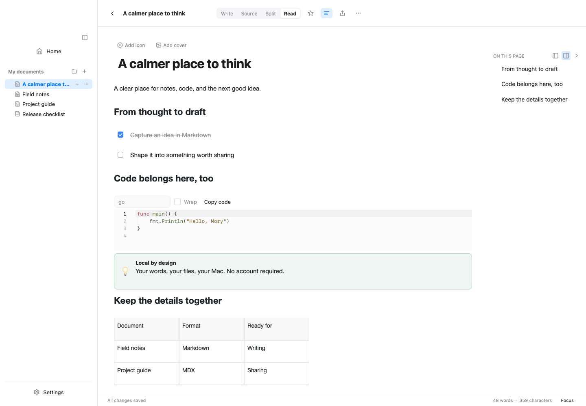
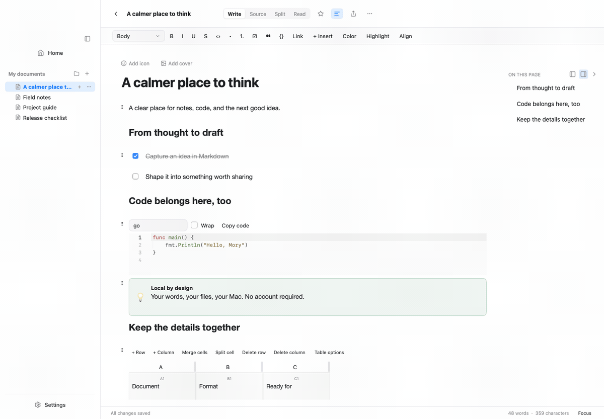

<p align="center">
  
</p>

<h1 align="center">Mory</h1>

<p align="center">A calm, local writing space for macOS.</p>

<p align="center"><a href="README.zh-CN.md">简体中文</a></p>

Mory is a native macOS writing app for Markdown, MDX, and Feishu/Lark DocxXML documents. Your library stays on this Mac: no account or background server is required.



<details>
<summary>Watch Mory switch between Write, Source, Split, and Read</summary>



</details>

## Highlights

- Four modes: **Write**, **Source**, **Split**, and **Read**; cycle with **Cmd+/**.
- Headings, lists, tasks, tables, code, LaTeX, callouts, columns, images, attachments, and document links.
- Static Docusaurus and MDX support. React components and JavaScript remain source text and are not executed.
- Folder cards and document previews, nested notes, search, favorites, batch actions, and a resizable sidebar.
- Full-width scrolling covers with an offline gallery and local uploads.
- The **yuluo** theme, custom CSS, light and dark appearance, and English and Simplified Chinese UI.
- Import files or folders; export Markdown, DocxXML, self-contained HTML, or PDF.

Open **Help → Open welcome guide** for the editor tour, or read the [English guide](resources/welcome.md) and [Chinese guide](resources/welcome.zh-CN.md). Use **Settings** to customize the editor, theme, and keyboard shortcuts.

## Get started

Download **Mory 0.0.3** for your Mac:

| Mac | Installer |
| --- | --- |
| Apple Silicon (M-series) | [macOS arm64](https://github.com/yuluo-yx/mory/releases/download/v0.0.3/mory-0.0.3-macos-arm64.dmg) |
| Intel (x86_64) | [macOS amd64](https://github.com/yuluo-yx/mory/releases/download/v0.0.3/mory-0.0.3-macos-amd64.dmg) |

[Release notes](https://github.com/yuluo-yx/mory/releases/tag/v0.0.3) · [SHA-256 checksums](https://github.com/yuluo-yx/mory/releases/download/v0.0.3/SHA256SUMS). Open the DMG and drag Mory to Applications. Packages are ad-hoc signed and not notarized by Apple; if macOS blocks the first launch, confirm **Open Anyway** in **System Settings → Privacy & Security**.

Open Mory to create a local library. Font and artwork notices are in [THIRD_PARTY.md](THIRD_PARTY.md).

## Library and recovery

The default library is `~/Documents/Mory`. Set `MORY_LIBRARY` to use another directory.

| Path | Contents |
| --- | --- |
| `notes/` | One Markdown or DocxXML file per Mory document, with embedded metadata |
| `assets/` | Local images and attachments |
| `history/` | Saved document revisions |
| `recovery/` | Recoverable content from failed or interrupted saves |
| `themes/` | Custom document themes and CSS |
| `plugins/` | Local JavaScript transforms |
| `settings.json` | Preferences and keyboard shortcuts |

Imports keep their original filenames. New notes use their titles, with numbered suffixes for name collisions. Sidebar folders are logical groups; **Open storage folder in Finder** opens the shared `notes/` directory.

Local images and attachments are copied into `assets/` without changing their bytes, up to **128 MiB per file**. Remote image downloads are limited to **32 MiB**. Markdown/XML exports copy local resources; HTML/PDF exports embed them. Remote URLs are not downloaded for export.

Mory autosaves after editing and offers recovery when saving fails. **Settings → Editor → Document history** controls revisions; defaults are a 5-minute interval, 30 days, 100 versions, and 64 MiB per document. Deleted folders and notes stay in Trash for 30 days; external originals remain on disk.

Back up the library before upgrading from older releases. Legacy JSON records and ID-based filenames migrate to readable Markdown/XML files while preserving contents and metadata. Older imports without filename metadata use their titles. To undo a storage migration, restore both the old application and the library backup.

## Plugins

Mory includes plugins for cleaning whitespace, reading statistics, and inserting a table of contents. To add a local plugin, place an ES module ending in `.js` in the library's `plugins/` directory and choose **Reload plugins** in Mory:

```js
export function transform({ title, markdown }) {
  return {
    markdown: markdown.replace(/TODO:/g, "- [ ]"),
    message: `Updated ${title}`,
  };
}
```

A plugin receives `{ title, markdown }` and may return `{ markdown }`, `{ message }`, or both. Plugins run locally in an isolated `moejs` runtime. Each source file is limited to 1 MiB, each run has a 750 ms deadline and 32 MiB memory limit, and file, network, environment, and Node.js APIs are unavailable.

## Performance

Measured editing and large-table workloads, methodology, and limitations are documented in the [performance comparison](benchmark/performance-comparison.md), [editing report](benchmark/performance-report.md), and [large-table report](benchmark/large-table-performance-report.md).

## Build from source

Mory requires macOS 13 or later. Go is pinned in [`mise.toml`](mise.toml), and dependency versions are locked in [`go.mod`](go.mod) and [`go.sum`](go.sum). Install `mise`, then run:

```sh
mise exec -- make test    # Unit and package tests
mise exec -- make check   # Tests, vet, native E2E, and combined coverage
mise exec -- make race    # Race detector
mise exec -- make bench   # Benchmarks
mise exec -- make run     # Development app
mise exec -- make build ARCH=arm64  # Apple Silicon app, DMG, and checksum
mise exec -- make build ARCH=amd64  # Intel app, DMG, and checksum
```

Build output is written to `build/darwin-arm64/` or `build/darwin-amd64/`; omitting `ARCH` selects the current Go architecture. GitHub Actions builds and tests both architectures on matching macOS runners, then publishes tagged releases with both DMGs and checksums. Local packages are ad-hoc signed. Native E2E tests and real-window performance measurements require a logged-in macOS desktop session.

`make check` runs unit tests, static checks, native E2E, and the 90% combined coverage gate. Tests use a temporary library. Real-window performance measurements can be run with `mise exec -- python3 scripts/performance.py`.

## License

Mory is released under the [MIT License](LICENSE). Dependency and artwork notices are listed in [`THIRD_PARTY.md`](THIRD_PARTY.md) and included in the application bundle.
