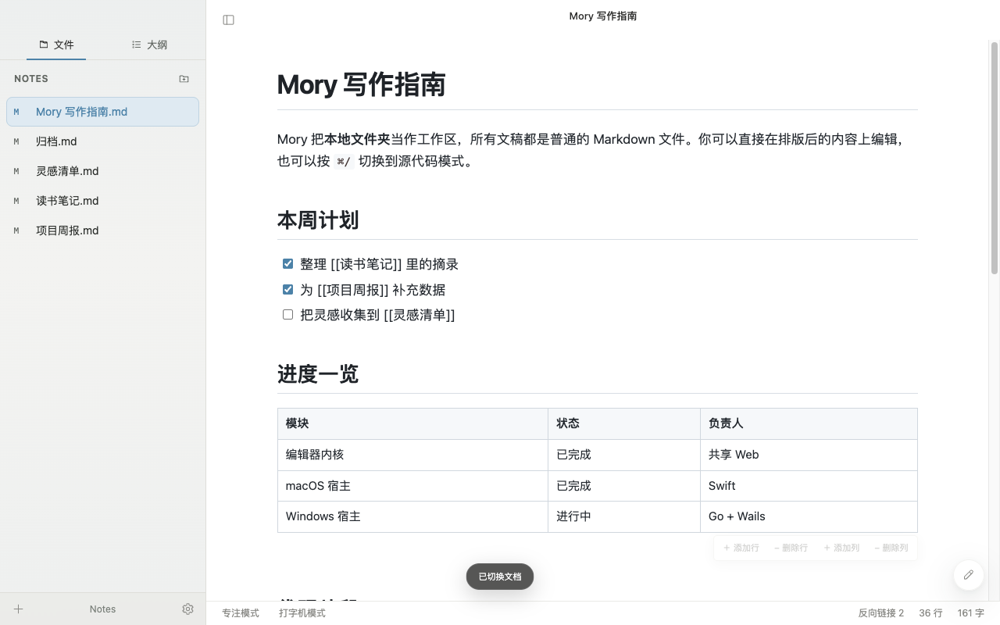
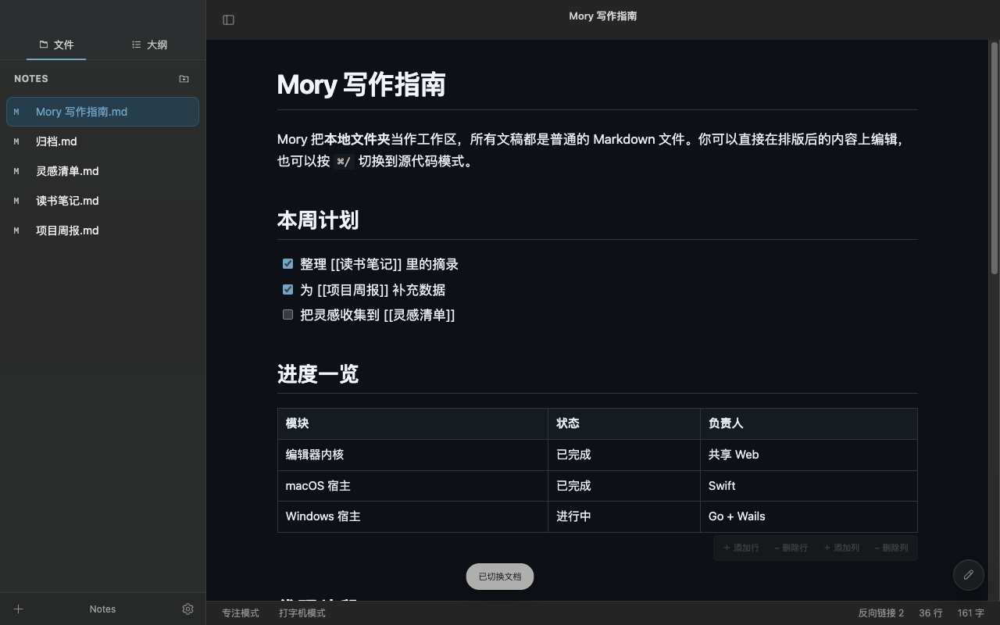
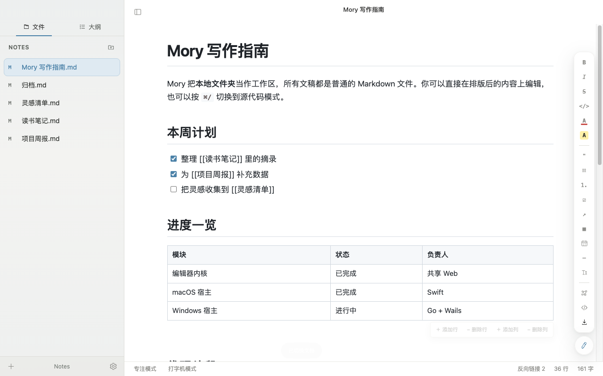
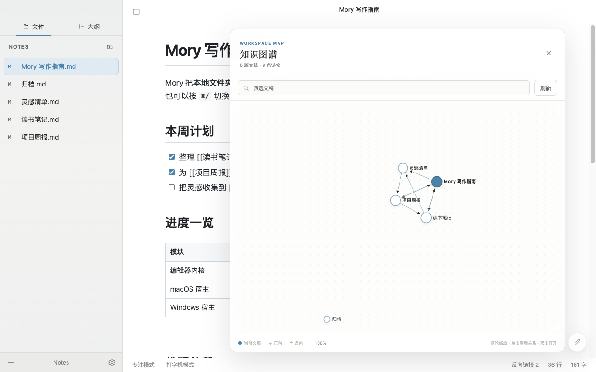

<p align="center">
  
</p>

<h1 align="center">Mory</h1>

<p align="center">
  本地优先的跨平台 Markdown 编辑器 · macOS / Windows<br>
  <strong>简体中文</strong> · <a href="README.en.md">English</a>
</p>



Mory 是一款面向 macOS 和 Windows 的 Markdown 编辑器。它由原生桌面宿主和一套共享的 Web 编辑内核组成，在保留纯 Markdown 文件的同时提供所见即所得的写作体验。工作区就是磁盘上的普通文件夹，不依赖专有数据库。

## 目录

- [名称](#名称)
- [功能](#功能)
- [截图](#截图)
- [架构与原理](#架构与原理)
- [技术栈](#技术栈)
- [快速开始](#快速开始)
- [构建与打包](#构建与打包)
- [启动与工作区](#启动与工作区)
- [命令行](#命令行)
- [测试](#测试)
- [目录结构](#目录结构)

## 名称

`Mory` 由 `M` 和 `ory` 组成。`M` 代表 Markdown 与 Memory，`ory` 取自 Story。这个名称表达了产品目标：用 Markdown 记录内容，并把分散文稿组织成可检索、可引用、可长期保存的个人记忆与故事。

项目正式名称为 `Mory`。应用名称、包名和发布制品均使用这一拼写。

## 功能

**写作**

- 所见即所得：直接编辑排版后的 Markdown，按 `⌘/` 切换源代码模式。
- 完整 Markdown：标题、列表、任务列表、表格、引用、链接、图片和分隔线。
- 代码块：使用 highlight.js 高亮，可折叠长代码块；标题也可以折叠。
- Mermaid：流程图、时序图等实时渲染，并提供 Mermaid 编辑面板。
- 日历块：在文稿中插入可交互的日历，记录日程和时间段。
- 一键排版：基于 pangu.js 在中英文之间补齐空格，保留代码和 HTML 属性。
- 文字颜色与背景色、查找和替换、专注模式、打字机模式、界面缩放。
- 右下角悬浮格式工具栏：平时收起为一个按钮，鼠标悬停时展开，不占用正文空间；单击按钮可固定展开，按 `Esc` 收起。

**工作区与知识组织**

- 本地文件夹即工作区，支持多级目录树、新建、重命名、复制、移动和删除（移到废纸篓）。
- 图片随文稿归档：粘贴或拖入的图片保存在文稿同名目录中，重命名和另存为时自动迁移路径。
- 双向链接：支持 `[[wiki 链接]]` 和相对路径 Markdown 链接，正文底部显示反向链接。
- 知识图谱：基于 D3 力导向布局展示文稿之间的引用关系，支持筛选、缩放和双击打开。
- 快速打开、最近打开的文稿和工作区、未保存内容的崩溃恢复。
- 外部修改实时同步：在其他编辑器或 Git 中修改文件后，文件树自动刷新。
- 可选的远程存储插件：S3、阿里云 OSS、GitHub 和 SFTP。本地工作区始终是默认方式。

**主题与导出**

- 8 套内置文档主题（GitHub、Lapis CV、Yuluo CSS、Whitey、Newsprint、Pixyll、Gothic、Night），支持导入自定义 CSS 主题。
- 浅色、深色和跟随系统三种外观；浮层使用毛玻璃效果。
- 导出 HTML、PDF、PNG、JPEG，以及通过 Slidev 导出 PowerPoint。导出内容与编辑区使用同一份主题化渲染结果。
- 简体中文和 English 界面可在设置中即时切换。

## 截图

| 浅色模式 | 深色模式 |
| --- | --- |
|  |  |

| 悬浮格式工具栏 | 知识图谱 |
| --- | --- |
|  |  |

截图由 `npx electron scripts/readme-screenshots/capture.cjs` 生成。脚本用示例文稿渲染真实界面，界面更新后重新运行即可刷新截图。

## 架构与原理

```text
┌───────────────────────────────────────────────────────────────┐
│                     共享 Web 编辑内核                          │
│  app.js（界面与状态） markdown.js（解析与序列化）              │
│  editor-features.js（编辑辅助） knowledge.js（链接与图谱）     │
│              ↓ scripts/build-web.mjs 打包为 app.bundle.js      │
└───────────────┬──────────────────┬──────────────────┬─────────┘
                │ hostRequest / 回调（JSON）           │
┌───────────────▼───┐  ┌───────────▼────────┐  ┌──────▼─────────────┐
│ macOS 原生宿主     │  │ Windows 宿主        │  │ Electron 兼容宿主   │
│ Swift + AppKit    │  │ Go + Wails         │  │ Node.js            │
│ WKWebView         │  │ WebView2           │  │ Chromium           │
│ FSEvents 监听      │  │ 签名轮询监听        │  │ fs.watch + 签名轮询 │
└─────────┬─────────┘  └─────────┬──────────┘  └─────────┬──────────┘
          └──────────────┬───────┴───────────────────────┘
                         ▼
        本地文件夹（Markdown + 图片目录） ／ mory-storage 远程同步插件
```

**共享编辑内核**。三个宿主加载同一份 `Sources/Mory/Web`。编辑区是一个 `contenteditable` 元素：`markdown.js` 把 Markdown 转换为 HTML 用于显示，编辑后再把 DOM 序列化回 Markdown，所以磁盘上始终是可读的纯文本。渲染出的 HTML 经过 DOMPurify 清洗，代码块交给 highlight.js，Mermaid 图在后台异步渲染。源代码模式直接编辑 Markdown 文本，两种模式共享撤销历史。

**宿主桥接**。Web 内核不直接访问文件系统。它通过 `hostRequest(method, args)` 向宿主发送 JSON 请求（例如 `workspaceDocuments`、`renameWorkspaceEntry`、`importImage`），宿主执行后调用 `window.Mory.resolveHostRequest` 返回结果。宿主也会主动推送状态，例如 `window.Mory.setWorkspaceSnapshot`（文件树）、`openDocument` 和 `didSave`。三个宿主实现同一套契约，因此编辑行为在各平台保持一致。

**工作区扫描与监听**。打开本地文件夹后，宿主单次遍历目录，生成文稿列表和目录列表，并识别"文稿同名图片目录"，把它们从目录树中隐藏。为了在大工作区中保持流畅：

- macOS 在后台串行队列执行扫描，主线程只负责把结果发送给 WebView；连续的文件变化会合并为一次补扫。
- 文稿一级标题按"文件大小 + 修改时间"缓存，未变化的文件不会被重复读取。
- FSEvents 与 Electron 监听会忽略 `.git`、`.DS_Store` 等隐藏路径的变化，Git 操作不会触发整树刷新。
- Electron 和 Windows 的兜底轮询只比较轻量的元数据签名，只有签名变化时才重新扫描。
- 知识图谱需要读取所有文稿正文，只有文件元数据变化时才重新读取；输入时只有标题或链接变化才重建图谱。

**知识图谱**。`knowledge.js` 从每篇文稿中提取 `[[wiki]]` 链接和相对路径 Markdown 链接（跳过代码块和行内代码），依次按完整路径、去扩展名路径和唯一文件名解析目标，生成节点、边和反向链接。图谱视图使用 D3 力导向布局。

**导出**。导出使用与编辑区相同的主题化 HTML。macOS 通过离屏 WKWebView 生成 PDF 和图片；Windows 和 Electron 使用各自的浏览器内核。PowerPoint 导出调用随包附带的 Slidev 侧车程序。所有导出先写入临时文件，成功后再替换目标文件。

**远程存储**。S3、OSS、GitHub 和 SFTP 由独立的 Go 程序 `mory-storage` 实现。宿主通过标准输入输出与它交换 JSON，凭据不会进入渲染进程状态。

## 技术栈

| 层 | 技术 |
| --- | --- |
| 编辑内核 | 原生 JavaScript（ES Modules）、DOMPurify 3、highlight.js 11、Mermaid 11、D3 7、pangu.js 9 |
| macOS 宿主 | Swift 6、AppKit、WKWebView、FSEvents、Swift Package Manager |
| Windows 宿主 | Go 1.26、Wails v2、WebView2、NSIS |
| Electron 兼容宿主 | Electron 44、electron-builder |
| 命令行与插件 | Go、Cobra、AWS SDK v2、阿里云 OSS SDK v2、go-github、pkg/sftp |
| PowerPoint 导出 | Slidev 侧车程序 |
| 测试 | Node.js 内置测试运行器、Electron 交互测试、Swift 原生冒烟测试、Go testing |

## 快速开始

构建环境需要 Node.js 22、npm 10 和 Go 1.26.6。macOS 构建还需要 Swift 6；Windows 安装包需要 NSIS。

```bash
npm ci        # 安装依赖
npm run dev   # 启动 Electron 开发壳
make verify   # 执行完整验证
```

修改 `Sources/Mory/Web` 下的源码后，运行 `npm run build:web` 重新生成 `app.bundle.js`。不要手动编辑打包产物和 `vendor/` 中的第三方运行时。

## 构建与打包

### macOS

生成当前架构的 Mory.app、DMG、ZIP 和 SHA-256 校验文件：

```bash
make package-macos
```

输出目录：

```text
dist/macos/Mory.app
dist/releases/Mory-<版本>-macos-<架构>.dmg
dist/releases/Mory-<版本>-macos-<架构>.zip
dist/releases/Mory-<版本>-macos-<架构>-SHA256SUMS.txt
```

### Windows

在 Windows PowerShell 中生成 x64 安装版和便携版：

```powershell
powershell -ExecutionPolicy Bypass `
  -File .\scripts\package-windows-wails.ps1 `
  -Architecture amd64
```

ARM64 使用 `-Architecture arm64`。安装 GNU Make 后，也可以同时生成两种架构：

```powershell
make package-windows
```

输出目录：

```text
dist\windows\Mory-Setup-<版本>-<架构>.exe
dist\windows\Mory-Portable-<版本>-<架构>.exe
```

在 macOS 或 Linux 上只能交叉编译 Windows GUI 可执行文件，不生成 NSIS 安装器：

```bash
make windows-build-x64 windows-build-arm64
```

## 启动与工作区

### 默认 Markdown 应用

打开 偏好设置 → 默认 Markdown 应用 → 设为默认应用，即可把 `.md` 文件关联到 Mory。

- macOS 原生应用通过系统 API 请求关联，系统拒绝时会如实提示。
- Windows 上该按钮会打开"默认应用"设置：搜索 `.md` 并选择 Mory。如果列表中没有 Mory，请先安装；便携版可能需要手动选择可执行文件。
- macOS 上的 Electron 兼容宿主会显示访达操作说明：选中一个 `.md` 文件，打开"显示简介"，在"打开方式"中选择 Mory，然后点击"全部更改"。

这是系统级文件关联，不是工作区设置。它不会修改文稿，也不会关联 `.txt` 文件。如需撤销，请在操作系统中重新选择默认应用。macOS 应用为 Markdown 文稿单独声明 Mory 图标；更新后访达可能短暂保留旧图标缓存，启动新版本后重新打开所在文件夹即可。

### 工作区

- 每次启动 Mory 都打开一篇空白文稿，不会自动恢复上次的工作区。只有首次使用且没有工作区记录时才显示介绍文档；之后可以通过 **帮助 > 用户指南** 再次打开。
- 使用 **文件 > 打开文件夹…** 把本地文件夹作为工作区，或通过 **文件 > 最近打开的工作区** 重新打开。Mory 会记住每个工作区上次访问的文稿。
- 工作区文件夹不存在时会提示错误，不会自动重新创建。移除或清除最近记录不会删除工作区设置和文件。
- 切换工作区时，未保存的文稿保持打开；重启后会恢复到新空白文稿旁边。正常保存后恢复缓存会被清除。回退到旧版本前，请先保存恢复的文稿。

## 命令行

发布包附带 Go 编写的 `mory` 客户端。它把渲染交给已安装的原生应用，因此命令行导出与编辑器使用相同的 Markdown 引擎、主题、Mermaid 和语法高亮。

```bash
mory guide.md                                   # 打开文稿
mory export --format=pdf --path=./ guide.md     # 导出到已有目录
mory export --format=jpg --path="./Export folder" -- "-draft.md"
```

- 支持 `html`、`pdf`、`png`、`jpeg`（别名 `jpg`，输出 `.jpg`）和 `pptx`。PowerPoint 导出需要应用说明中的 Slidev 环境。
- 默认不覆盖已有文件；传入 `--force` 替换输出文件。`--force` 只接受普通文件，拒绝目录、符号链接（包括失效链接）和指向源文稿的硬链接。
- 导出先在目标位置旁渲染，成功后才发布。失败、取消、为空或不完整的渲染会保留原文件。
- 应用不在标准位置时，用 `--app=/path/to/Mory.app`（macOS）或 `--app=C:\path\to\Mory.exe`（Windows）指定。
- macOS 上把发布的 `*-cli` 制品复制到 `PATH` 中的目录，例如 `/usr/local/bin/mory`；CLI 也内置在 `Mory.app/Contents/Resources/bin/mory`。Windows 上把 `Mory-CLI-<版本>-<架构>.exe` 重命名为 `mory.exe` 并放到 `PATH` 中，同时保持 Mory 已安装。

## 测试

```bash
npm run check                                     # 语言检查、打包校验与语法检查
npm test                                          # JavaScript 单元测试与覆盖率
env GOCACHE="$PWD/.cache/go-build" go test ./...  # Go 测试
npm run test:e2e                                  # Electron 交互测试
npm run test:lifecycle                            # Electron 保存与文稿生命周期
npm run test:mac-web                              # macOS WKWebView 冒烟测试
npm run test:mac-lifecycle                        # macOS 原生保存契约
npm run test:mac-workspace-boundaries             # 工作区边界与扫描
npm run test:mac-workspace-watcher                # FSEvents 监听
```

执行 `npm run build:mac` 后，运行 `npm run test:mac-cli` 验证打包后的命令行客户端，覆盖 HTML、PDF、PNG、JPG、输出冲突、替换、源文件保护以及带空格或以短横线开头的文件名。`make package-macos` 在生成发布包之前会执行这项检查。

生命周期测试覆盖保存过程中输入或切换标签、保存完成前关闭文稿、重新打开未保存内容、另存为时复制图片、延迟导入图片、部分失败和撤销。另存为会保留原文稿的图片目录，并拒绝合并到已存在的目标图片目录；遇到这种冲突时，请换一个名称或位置。

## 目录结构

```text
Sources/Mory/          macOS 原生宿主（Swift）
Sources/Mory/Web/      共享 Web 编辑内核、主题、模板和第三方运行时
Electron/              Electron 兼容宿主
cmd/mory/              命令行客户端
cmd/mory-windows/      Windows Wails 宿主入口
cmd/mory-storage/      远程存储同步插件
cmd/mory-slidev/       Slidev 导出侧车程序
internal/              Windows 宿主、存储、导出等 Go 包
appcli/                命令行与原生应用的交互
Tests/                 单元测试、交互测试和原生冒烟测试
scripts/               构建、打包、测试与截图脚本
assets/                应用图标、DMG 背景和 README 截图
```
