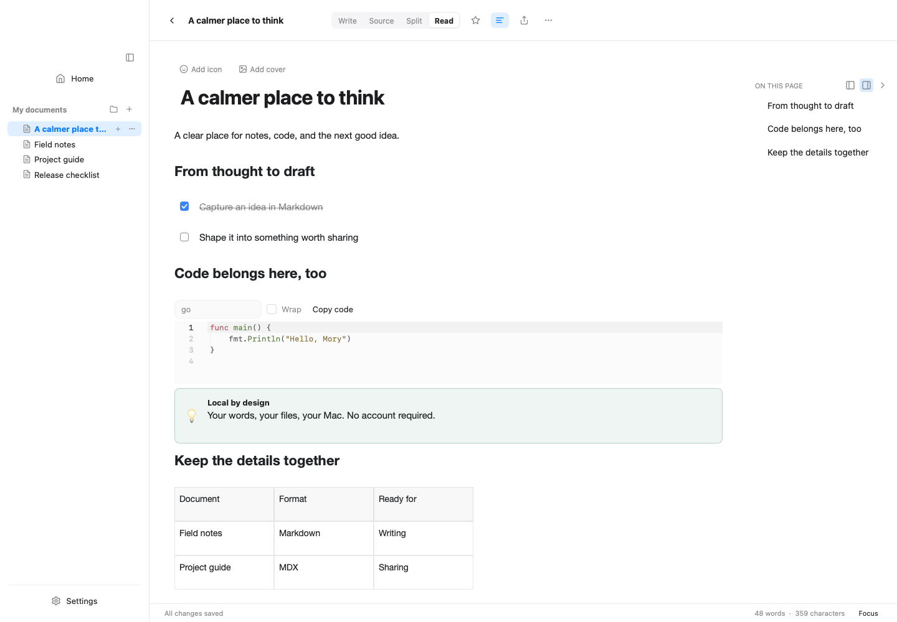
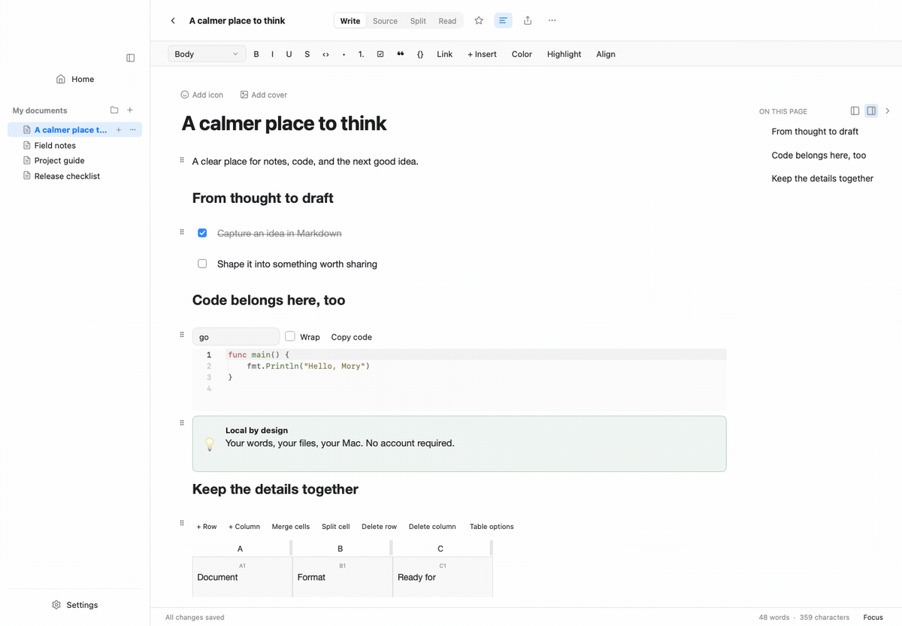

<p align="center">
  
</p>

<h1 align="center">Mory</h1>

<p align="center">A calm, local writing space for macOS.</p>

<p align="center"><a href="README.zh-CN.md">简体中文</a></p>

Mory is a native macOS writing app for Markdown, MDX, and Feishu/Lark DocxXML documents. Your library stays on this Mac: no account or background server is required.



<details>
<summary>Watch Mory switch between Write, Source, Split, and Read</summary>



</details>

## Highlights

- Four editing modes: **Write**, **Source**, **Split**, and **Read**.
- Native editing for headings, lists, tasks, tables, LaTeX, code blocks, callouts, tabs, columns, images, attachments, and document links.
- Static Docusaurus and MDX support, including front matter, admonitions, heading IDs, code metadata, details, and tabs. React components, JavaScript expressions, and site-specific build plugins remain source text and are not executed.
- Local organization with folders, nested documents, favorites, pins, search, manual ordering, batch actions, multiple windows, and quick notes.
- Five document themes, editable CSS, light and dark appearance, and English and Simplified Chinese UI.
- Import files or folders and export Markdown, DocxXML, self-contained HTML, or PDF.
- Local and remote images. Relative local assets are stored beside their document; `http(s)` image URLs are rendered when online and remain URLs in the document source.

The editable feature tour is available from **Help → Open welcome guide**. A new library starts with both English and Chinese welcome documents. The complete source is also available as [the English guide](resources/welcome.md) and [the Chinese guide](resources/welcome.zh-CN.md).

## Get started

Download **Mory 0.0.1 Alpha** for your Mac:

| Mac | Installer |
| --- | --- |
| Apple Silicon (M-series) | [macOS arm64](https://github.com/yuluo-yx/mory/releases/download/v0.0.1-alpha.1/mory-0.0.1-alpha.1-macos-arm64.dmg) |
| Intel (x86_64) | [macOS amd64](https://github.com/yuluo-yx/mory/releases/download/v0.0.1-alpha.1/mory-0.0.1-alpha.1-macos-amd64.dmg) |

[Release notes](https://github.com/yuluo-yx/mory/releases/tag/v0.0.1-alpha.1) · [SHA-256 checksums](https://github.com/yuluo-yx/mory/releases/download/v0.0.1-alpha.1/SHA256SUMS). Open the DMG and drag Mory to Applications. Alpha packages are ad-hoc signed and not notarized by Apple; if macOS blocks the first launch, confirm **Open Anyway** in **System Settings → Privacy & Security**.

Open Mory to create a local library, then use the English or Chinese welcome guide as the starting point. The complete editor tour and syntax reference live in [`resources/welcome.md`](resources/welcome.md) and [`resources/welcome.zh-CN.md`](resources/welcome.zh-CN.md).

Mory bundles [Luo Regular](https://github.com/tw93/Luo) for Chinese text in its native interface and built-in writing styles. The font works offline without a system installation. Latin text and code retain their native fonts, while Chinese characters outside Luo's coverage and emoji use macOS fallback fonts. Custom CSS keeps its authored font cascade; add `"Luo"` after a Latin family to opt in, for example `font-family: "Helvetica Neue", "Luo", sans-serif`. Native macOS menus and HTML/PDF export retain their existing typography. Font provenance and the SIL OFL 1.1 notice are recorded in [`THIRD_PARTY.md`](THIRD_PARTY.md).

## Library and recovery

The default library is `~/Documents/Mory`. Set `MORY_LIBRARY` to use another directory.

| Path | Contents |
| --- | --- |
| `notes/` | One JSON record per Mory document, including its source and metadata |
| `assets/` | Local images and attachments |
| `history/` | Saved document revisions |
| `recovery/` | Recoverable content from failed or interrupted saves |
| `themes/` | Custom document themes and CSS |
| `plugins/` | Local JavaScript transforms |
| `settings.json` | Preferences and keyboard shortcuts |

Local asset files use the SHA-256 digest of their content as the filename prefix, so the document stores a stable relative reference such as `assets/6cbb4a435a30b8abe4bb23b1.png`. A single inserted or imported asset may be up to 32 MiB.

Autosave starts after editing begins and writes changed content about every 750 ms using atomic replacement. If saving fails, Mory keeps the edit buffer and writes recovery content when possible; recovery is offered on the next launch.

**Settings → Editor → Document history** controls revisions independently from autosave. The defaults are a 5-minute checkpoint interval, 30-day retention, 100 versions, and 64 MiB per document. Older versions are coalesced and pruned when changed content is saved or history is opened. Disabling history stops new snapshots and pruning without deleting existing copies. Restoring a revision first checkpoints the current document.

Importing a document copies local assets into the destination library and rewrites their relative paths. Markdown and DocxXML exports copy local assets into an `assets/` directory. HTML and PDF exports embed local images. Remote URLs remain remote and are not fetched for export.

Existing libraries require no migration. Back up the library before maintenance or manual cleanup; replacing the application cannot recover revisions that have already been pruned.

## Plugins

Mory includes plugins for cleaning whitespace, reading statistics, and inserting a table of contents. To add a local plugin, place an ES module ending in `.js` in the library's `plugins/` directory and choose **Reload plugins** in Mory:

```js
export function transform({ title, markdown }) {
  return {
    markdown: markdown.replace(/TODO:/g, "- [ ]"),
    message: `Updated ${title}`,
  };
}
```

A plugin receives `{ title, markdown }` and may return `{ markdown }`, `{ message }`, or both. Plugins run locally in an isolated `moejs` runtime. Each source file is limited to 1 MiB, each run has a 750 ms deadline and 32 MiB memory limit, and file, network, environment, and Node.js APIs are unavailable.

## Performance snapshot

Mory's performance strengths are **low input-processing cost** and **complete large-table reading with bounded rendering work**. On an Apple M4 with 24 GiB RAM, the recorded 1 MiB structured and mixed-format documents have median edit actions below **0.05 ms**. Full-table navigation, including rendering and PNG capture, takes about **35–37 ms** across the three table fixtures.

<p align="center">
  
</p>

| Write workload | Edit action | Edit + rendering + PNG capture | Save, including serialization |
| --- | ---: | ---: | ---: |
| Structured document, 1 MiB | **0.044 ms** | 55.88 ms | 88.56 ms |
| Mixed-format document, 1 MiB | **0.043 ms** | 53.53 ms | 61.99 ms |

Large-table reading covers **401–3,206 rows**, with loaded RSS of about **201–238 MiB**. Every row remains accessible, with pinned headers and wrapped cells. The editing matrix contains 36 independent runs and 1,080 edits; the table-reading matrix contains 18 runs and 162 verified row jumps. Values are medians across three runs. Input actions exclude rendering; capture includes PNG encoding, so neither is keyboard-to-display latency.

Reference editors: **ArcMD v0.0.11** and **Quiet.md v0.1.11**. Mory's measured strengths and the comparison boundaries are documented in the [performance comparison](benchmark/performance-comparison.md); different measurement workflows are not expressed as speed ratios. See the [editing data](benchmark/performance-report.md) and [full-table reading data](benchmark/large-table-performance-report.md) for reproducible results and raw samples.

## Build from source

Mory requires macOS 13 or later. Go is pinned in [`mise.toml`](mise.toml), and dependency versions are locked in [`go.mod`](go.mod) and [`go.sum`](go.sum). Install `mise`, then run:

```sh
mise exec -- make test    # Unit and package tests
mise exec -- make check   # Tests, vet, native E2E, and combined coverage
mise exec -- make race    # Race detector
mise exec -- make bench   # Benchmarks
mise exec -- make run     # Development app
mise exec -- make build ARCH=arm64  # Apple Silicon app, DMG, and checksum
mise exec -- make build ARCH=amd64  # Intel app, DMG, and checksum
```

Build output is written to `build/darwin-arm64/` or `build/darwin-amd64/`; omitting `ARCH` selects the current Go architecture. GitHub Actions builds and tests both architectures on matching macOS runners, then publishes tagged releases with both DMGs and checksums. Local packages are ad-hoc signed. Native E2E tests and real-window performance measurements require a logged-in macOS desktop session:

```sh
mise exec -- python3 scripts/performance.py
```

## License

Mory is released under the [MIT License](LICENSE). Dependency and artwork notices are listed in [`THIRD_PARTY.md`](THIRD_PARTY.md) and included in the application bundle.
