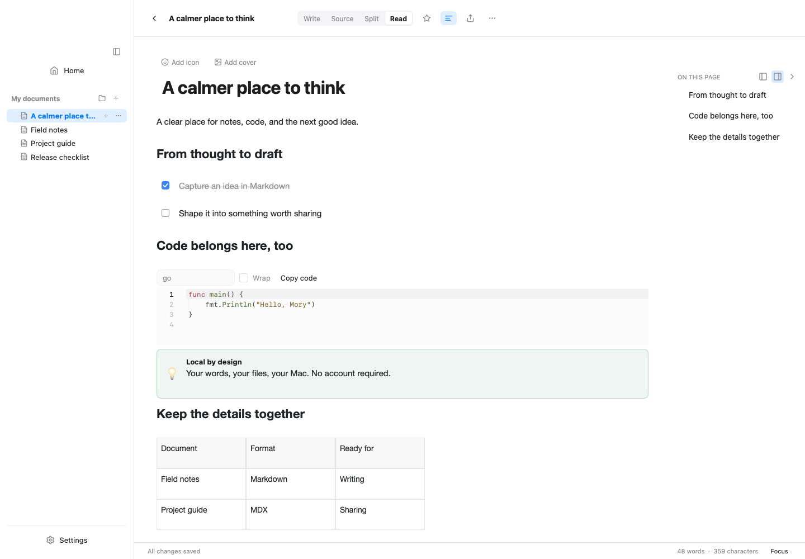
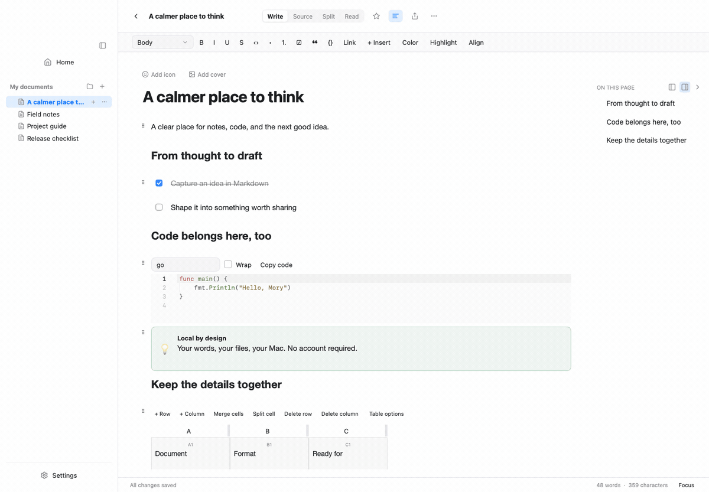

<p align="center">
  
</p>

<h1 align="center">Mory</h1>

<p align="center">macOS 上安静的本地写作空间。</p>

<p align="center"><a href="README.md">English</a></p>

Mory 是一款原生 macOS 写作应用，支持 Markdown、MDX 和飞书/Lark DocxXML 文档。文档库保存在本机，无需账号，也不需要后台服务器。



<details>
<summary>查看 Mory 写作、源码、分屏和阅读模式的切换演示</summary>



</details>

## 主要功能

- **写作**、**源码**、**分屏**和**阅读**四种模式，通过 **Cmd+/** 循环切换。
- 支持标题、列表、任务、表格、代码、LaTeX、提示块、分栏、图片、附件和文档链接。
- 支持静态 Docusaurus 和 MDX；React 组件与 JavaScript 保留为源码，不会执行。
- 文件夹卡片、文稿预览、嵌套文稿、搜索、收藏、批量操作和可调整宽度的侧栏。
- 铺满顶部并随文稿滚动的封面，提供离线图库和本地上传。
- **yuluo** 主题、自定义 CSS、浅色和深色外观、中英文界面。
- 导入文件或文件夹，导出 Markdown、DocxXML、自包含 HTML 或 PDF。

从 **帮助 → 打开欢迎指南** 查看编辑器介绍，也可阅读[英文指南](resources/welcome.md)和[中文指南](resources/welcome.zh-CN.md)。编辑器、主题和快捷键均可在 **设置** 中调整。

## 快速开始

根据 Mac 的芯片下载 **Mory 0.0.3**：

| Mac 类型 | 安装包 |
| --- | --- |
| Apple Silicon（M 系列） | [macOS arm64](https://github.com/yuluo-yx/mory/releases/download/v0.0.3/mory-0.0.3-macos-arm64.dmg) |
| Intel（x86_64） | [macOS amd64](https://github.com/yuluo-yx/mory/releases/download/v0.0.3/mory-0.0.3-macos-amd64.dmg) |

[发布说明](https://github.com/yuluo-yx/mory/releases/tag/v0.0.3) · [SHA-256 校验和](https://github.com/yuluo-yx/mory/releases/download/v0.0.3/SHA256SUMS)。打开 DMG，将 Mory 拖入“应用程序”。安装包使用 ad-hoc 签名，尚未经过 Apple 公证；如果 macOS 拦截首次启动，可在 **系统设置 → 隐私与安全性** 中确认“仍要打开”。

打开 Mory 即可创建本地文档库。字体及美术资源声明见 [THIRD_PARTY.md](THIRD_PARTY.md)。

## 文档库与恢复

默认文档库位于 `~/Documents/Mory`。设置 `MORY_LIBRARY` 环境变量可以使用其他目录。

| 路径 | 内容 |
| --- | --- |
| `notes/` | 每篇 Mory 文档的 Markdown 或 DocxXML 文件，内嵌元数据 |
| `assets/` | 本地图片和附件 |
| `history/` | 已保存的文档版本 |
| `recovery/` | 保存失败或中断时保留的可恢复内容 |
| `themes/` | 自定义文档主题和 CSS |
| `plugins/` | 本地 JavaScript 转换插件 |
| `settings.json` | 偏好设置和快捷键 |

导入文稿保留原文件名，新文稿使用标题命名；重名时自动添加序号。侧栏文件夹是逻辑分组，「在访达中打开存储文件夹」会打开共享的 `notes/` 目录。

本地图片和附件复制到 `assets/`，保留原始内容，**每个文件上限为 128 MiB**；远程图片下载上限为 **32 MiB**。Markdown/XML 导出会复制本地资源，HTML/PDF 导出会嵌入本地图片；远程 URL 不会被下载。

Mory 在编辑后自动保存，保存失败时提供恢复功能。**设置 → 编辑器 → 文档历史** 控制历史版本，默认每 5 分钟记录一次，保留 30 天、100 个版本，每篇文稿最多 64 MiB。删除的文件夹和文稿在回收站保留 30 天，外部原文件仍留在磁盘上。

从旧版本升级前，请备份完整文档库。旧版 JSON 记录和 ID 文件名会转换为可读文件名的 Markdown/XML 文件，保留内容和元数据；没有原文件名记录的旧导入文稿使用标题命名。撤销存储迁移时，需要同时恢复旧应用和迁移前的文档库备份。

## 插件

Mory 内置清理空白、阅读统计和插入目录插件。添加本地插件时，将扩展名为 `.js` 的 ES 模块放入文档库的 `plugins/` 目录，然后在 Mory 中选择 **重新加载插件**：

```js
export function transform({ title, markdown }) {
  return {
    markdown: markdown.replace(/TODO:/g, "- [ ]"),
    message: `Updated ${title}`,
  };
}
```

插件接收 `{ title, markdown }`，可以返回 `{ markdown }`、`{ message }` 或两者。插件在隔离的 `moejs` 运行时中执行。每个源文件最大为 1 MiB，每次运行最长 750 ms，内存上限为 32 MiB，并且不能访问文件、网络、环境变量或 Node.js API。

## 性能

编辑与大表格场景的实测数据、方法和适用范围见[性能对比](benchmark/performance-comparison.md)、[编辑性能报告](benchmark/performance-report.md)和[大表格阅读报告](benchmark/large-table-performance-report.md)。

## 从源码构建

Mory 需要 macOS 13 或更高版本。Go 版本固定在 [`mise.toml`](mise.toml)，依赖版本锁定在 [`go.mod`](go.mod) 和 [`go.sum`](go.sum)。安装 `mise` 后执行：

```sh
mise exec -- make test    # Unit and package tests
mise exec -- make check   # Tests, vet, native E2E, and combined coverage
mise exec -- make race    # Race detector
mise exec -- make bench   # Benchmarks
mise exec -- make run     # Development app
mise exec -- make build ARCH=arm64  # Apple Silicon app, DMG, and checksum
mise exec -- make build ARCH=amd64  # Intel app, DMG, and checksum
```

构建产物分别写入 `build/darwin-arm64/` 和 `build/darwin-amd64/`；省略 `ARCH` 时使用当前 Go 架构。GitHub Actions 会在对应架构的 macOS runner 上构建和测试，再为版本标签发布两个 DMG 及校验和。本地安装包使用 ad-hoc 签名。原生 E2E 测试和真实窗口性能测试需要已登录的 macOS 桌面会话：

```sh
mise exec -- python3 scripts/performance.py
```

`make check` 执行单元测试、静态检查、原生 E2E 和 90% 合并覆盖率检查，测试使用临时文档库。

## 许可证

Mory 使用 [MIT License](LICENSE) 发布。依赖和美术资源声明见 [`THIRD_PARTY.md`](THIRD_PARTY.md)，并包含在应用包中。
