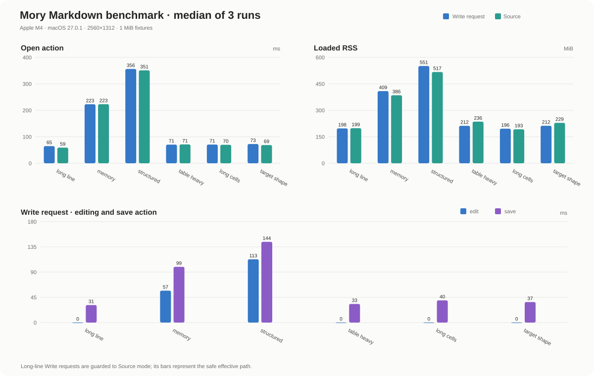

<p align="center">
  
</p>

<h1 align="center">Mory</h1>

<p align="center">macOS 上安静的本地写作空间。</p>

<p align="center"><a href="README.md">English</a></p>

Mory 是一款原生 macOS 写作应用，支持 Markdown、MDX 和飞书/Lark DocxXML 文档。文档库保存在本机，无需账号，也不需要后台服务器。

## 主要功能

- 四种编辑模式：**写作**、**源码**、**分屏**和**阅读**。
- 原生支持标题、列表、任务、表格、LaTeX、代码块、提示块、标签页、分栏、图片、附件和文档链接。
- 支持静态 Docusaurus 和 MDX，包括 front matter、admonition、标题 ID、代码元数据、details 和 tabs。React 组件、JavaScript 表达式及站点专用构建插件会保留为源码，不会执行。
- 支持文件夹、嵌套文档、收藏、置顶、搜索、手动排序、批量操作、多窗口和快速笔记。
- 提供五种文档主题、可编辑 CSS、浅色和深色外观，以及英文和简体中文界面。
- 支持导入文件或文件夹，并导出 Markdown、DocxXML、自包含 HTML 或 PDF。
- 支持本地和远程图片。本地相对路径资源会保存在文档旁；在线时会渲染 `http(s)` 图片地址，并在文档源码中保留原 URL。

可以从 **帮助 → 打开欢迎指南** 查看完整的功能介绍。新建文档库时会同时创建英文和中文欢迎文档，完整内容见[英文指南](resources/welcome.md)和[中文指南](resources/welcome.zh-CN.md)。

## 快速开始

打开 Mory 创建本地文档库，然后从英文或中文欢迎指南开始。完整的编辑器介绍和语法参考见 [`resources/welcome.md`](resources/welcome.md) 与 [`resources/welcome.zh-CN.md`](resources/welcome.zh-CN.md)。

## 文档库与恢复

默认文档库位于 `~/Documents/Mory`。设置 `MORY_LIBRARY` 环境变量可以使用其他目录。

| 路径 | 内容 |
| --- | --- |
| `notes/` | 每篇 Mory 文档的一条 JSON 记录，包含源码和元数据 |
| `assets/` | 本地图片和附件 |
| `history/` | 已保存的文档版本 |
| `recovery/` | 保存失败或中断时保留的可恢复内容 |
| `themes/` | 自定义文档主题和 CSS |
| `plugins/` | 本地 JavaScript 转换插件 |
| `settings.json` | 偏好设置和快捷键 |

本地资源文件名使用内容的 SHA-256 摘要前缀，因此文档会保存类似 `assets/6cbb4a435a30b8abe4bb23b1.png` 的稳定相对路径。单个插入或导入的资源最大为 32 MiB。

开始编辑后，Mory 会自动保存，并大约每 750 ms 使用原子替换写入变更内容。保存失败时，Mory 会保留编辑缓冲区，并在可能的情况下写入恢复内容；下次启动时会提供恢复选项。

**设置 → 编辑器 → 文档历史** 独立控制版本历史和自动保存。默认每 5 分钟创建一次检查点，保留 30 天、最多 100 个版本，每篇文档最多占用 64 MiB。文档保存或打开历史时，旧版本会合并并清理。关闭历史后不会创建新快照或清理旧快照，但已有版本仍然保留。恢复历史版本前，Mory 会先为当前文档创建检查点。

导入文档时，本地资源会复制到目标文档库，并改写相对路径。导出 Markdown 和 DocxXML 时，本地资源会复制到 `assets/` 目录；导出 HTML 和 PDF 时，本地图片会嵌入文件。远程 URL 会保持为远程地址，导出时不会下载。

已有文档库无需迁移。维护或手动清理前请先备份文档库；应用替换后无法恢复已经清理的历史版本。

## 插件

Mory 内置清理空白、阅读统计和插入目录插件。添加本地插件时，将扩展名为 `.js` 的 ES 模块放入文档库的 `plugins/` 目录，然后在 Mory 中选择 **重新加载插件**：

```js
export function transform({ title, markdown }) {
  return {
    markdown: markdown.replace(/TODO:/g, "- [ ]"),
    message: `Updated ${title}`,
  };
}
```

插件接收 `{ title, markdown }`，可以返回 `{ markdown }`、`{ message }` 或两者。插件在隔离的 `moejs` 运行时中执行。每个源文件最大为 1 MiB，每次运行最长 750 ms，内存上限为 32 MiB，并且不能访问文件、网络、环境变量或 Node.js API。

## 性能概览

性能是 Mory 的核心优势之一。基准测试使用仓库中固定的 1 MiB Markdown fixture，对比写作请求路径和源码模式。遇到没有换行的超长单行文本时，Mory 会自动使用源码模式，避免富文本编辑器进行无界内存分配。

<p align="center">
  
</p>

与 Quiet.md `v0.1.11` 使用同一组 fixture 测试时，Mory 在复杂文档上的优势是性能更稳定：Mory 测得的 RSS 峰值约保持在 `682 MiB` 以内，而 Quiet.md 在表格密集和目标负载文档上达到 `2.1–2.4 GiB`，采样 CPU 接近 `100%`。Quiet.md 在简单文档上的内存占用更低（`207–296 MiB`），因此差异取决于文档负载；完整数据见 [Quiet.md 性能基线](benchmark/quiet-md-performance-report.md)。两组数据的指标层级不同：Mory 记录编辑操作和画面捕获耗时，Quiet.md 基线记录发布包进程的 RSS 和 CPU。

详见 [性能数据](benchmark/performance-report.md) 和 [原始测量结果](benchmark/performance-data.jsonl)。

## 从源码构建

Mory 需要 macOS 13 或更高版本。Go 版本固定在 [`mise.toml`](mise.toml)，依赖版本锁定在 [`go.mod`](go.mod) 和 [`go.sum`](go.sum)。安装 `mise` 后执行：

```sh
mise exec -- make test    # Unit and package tests
mise exec -- make check   # Tests, vet, native E2E, and combined coverage
mise exec -- make race    # Race detector
mise exec -- make bench   # Benchmarks
mise exec -- make run     # Development app
mise exec -- make build   # Universal macOS app, DMG, and checksum
```

构建产物写入 `build/darwin-universal/`。本地安装包使用 ad-hoc 签名。原生 E2E 测试和真实窗口性能测试需要已登录的 macOS 桌面会话：

```sh
mise exec -- python3 scripts/performance.py
```

## 许可证

Mory 使用 [MIT License](LICENSE) 发布。依赖和美术资源声明见 [`THIRD_PARTY.md`](THIRD_PARTY.md)，并包含在应用包中。
