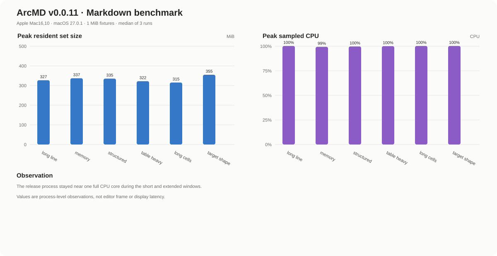

# ArcMD performance data

This benchmark records the installed ArcMD release package and keeps the product version with every result for later comparisons.

## Build identity

| Field | Value |
| --- | --- |
| Product | ArcMD |
| Version | `v0.0.11` |
| Source revision | `f5c37c7cb7e284ff78bdee1a0f369bc3a0d061c4` |
| Package | macOS arm64 release DMG |
| Package SHA-256 | `a66315c0ab71772c7b8a474410835186cec6cdd9a59635f970d3f4513a02178b` |
| Machine | Apple Mac16,10 (Apple Silicon), 24 GiB |
| OS | macOS 27.0.1 |
| Fixture set | 6 Markdown documents, approximately 1 MiB each |
| Repetitions | 3 independent processes per fixture |

## Process-level results

The installed release binary was started with each fixture as a command-line input and an isolated `ARCMD_HOME` directory. RSS and CPU were sampled every 250 ms for approximately 3.7 s. “Peak RSS” and “Peak CPU” are the median and P95 over the three runs; “RSS at end” is the resident set at the end of that window. The 90% column is the median time to reach 90% of that run’s peak RSS. Each process was force-terminated after sampling.

| Fixture | Peak RSS median / P95 (MiB) | RSS at end median / P95 (MiB) | Peak CPU median / P95 | 90% peak RSS (ms) |
| --- | ---: | ---: | ---: | ---: |
| `long-line-1m.md` | 327.03 / 332.32 | 327.03 / 332.32 | 100.3% / 102.4% | 261.5 |
| `memory-heavy-1m.md` | 337.08 / 348.78 | 337.08 / 348.78 | 99.4% / 100.4% | 261.3 |
| `structured-1m.md` | 335.19 / 351.29 | 335.19 / 351.29 | 99.8% / 100.2% | 262.1 |
| `table-heavy-1m.md` | 322.22 / 341.53 | 322.22 / 341.53 | 100.1% / 100.2% | 261.6 |
| `table-long-cells-1m.md` | 315.31 / 328.31 | 315.31 / 328.31 | 100.3% / 100.5% | 261.9 |
| `target-shape-12x1m.md` | 355.11 / 355.25 | 355.11 / 355.25 | 100.3% / 100.9% | 262.1 |

## Extended observation

A 15-second observation of `structured-1m.md` reached a peak RSS of 354.11 MiB and ended at 353.97 MiB while sampled CPU remained 99.4% at the end. This indicates sustained process activity during the observation window; it is not a settled idle baseline.

## Measurement boundary

This is a release-process measurement using RSS and `ps` CPU samples. It does not claim editor frame time, GPU presentation latency, or end-to-end typing latency. ArcMD’s upstream performance report uses a separate headless frame pipeline, so its CPU scene timings are not mixed into this local release-package report.

Raw per-run data: [`arcmd-performance-data.jsonl`](arcmd-performance-data.jsonl).
