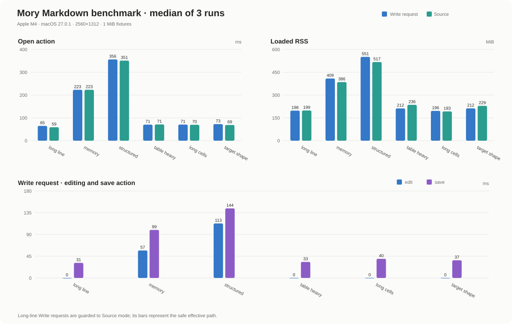

# Mory performance data

Mory **0.1.0**, Apple M4, 24 GiB, macOS-27.0.1-arm64-arm-64bit-Mach-O; requested window 2560x1312. Six checked-in 1 MiB fixtures, Write and Source modes, three fresh processes per case, 30 edits per process. Values below are medians across runs; edit values use each run's median. RSS is sampled every 50 ms. Long-line Write requests use the existing Source fallback; large tables retain the existing compact preview. These results do not measure full rich rendering of every table cell.

## Before / after

| Fixture | Mode | Open (ms) | Edit (ms) | Save (ms) | Loaded RSS (MiB) | Peak RSS (MiB) |
| --- | --- | ---: | ---: | ---: | ---: | ---: |
| `long-line-1m` | Source | 57.23 / 68.26 | 0.03 / 0.03 | 33.74 / 33.28 | 197.94 / 197.12 | 244.73 / 247.70 |
| `long-line-1m` | Write | 60.86 / 53.78 | 0.03 / 0.03 | 33.79 / 36.10 | 194.58 / 193.62 | 246.17 / 240.45 |
| `memory-heavy-1m` | Source | 224.49 / 213.39 | 0.03 / 0.03 | 33.78 / 40.08 | 363.72 / 297.38 | 482.75 / 371.89 |
| `memory-heavy-1m` | Write | 238.64 / 207.82 | 53.39 / 28.13 | 90.65 / 61.78 | 394.36 / 319.16 | 464.77 / 419.08 |
| `structured-1m` | Source | 336.25 / 303.77 | 0.04 / 0.03 | 34.56 / 33.00 | 503.72 / 384.14 | 647.42 / 495.17 |
| `structured-1m` | Write | 327.11 / 298.26 | 109.23 / 58.76 | 140.71 / 104.07 | 550.31 / 411.67 | 644.73 / 518.09 |
| `table-heavy-1m` | Source | 71.25 / 88.85 | 0.03 / 0.03 | 36.34 / 31.60 | 229.83 / 237.70 | 346.64 / 301.97 |
| `table-heavy-1m` | Write | 73.09 / 83.57 | 0.09 / 0.13 | 34.70 / 40.37 | 210.02 / 211.70 | 236.73 / 244.72 |
| `table-long-cells-1m` | Source | 73.30 / 79.92 | 0.03 / 0.03 | 40.99 / 40.48 | 192.33 / 197.97 | 243.02 / 233.86 |
| `table-long-cells-1m` | Write | 77.97 / 75.75 | 0.11 / 0.11 | 39.29 / 36.28 | 194.89 / 197.59 | 235.17 / 237.02 |
| `target-shape-12x1m` | Source | 70.19 / 69.79 | 0.03 / 0.03 | 37.83 / 36.23 | 220.38 / 214.58 | 359.89 / 292.61 |
| `target-shape-12x1m` | Write | 78.14 / 79.29 | 0.10 / 0.10 | 33.90 / 33.44 | 205.92 / 216.23 | 238.22 / 242.73 |

## Edit tail latency and capture

P95 uses the nearest-rank percentile within each run, then the median of the three runs. Capture includes the action, window rendering and PNG encoding; it is not display latency.

| Fixture | Mode | Edit P95 before / after (ms) | Capture median before / after (ms) |
| --- | --- | ---: | ---: |
| `long-line-1m` | Source | 0.04 / 0.05 | 65.21 / 66.92 |
| `long-line-1m` | Write | 0.04 / 0.04 | 64.88 / 67.74 |
| `memory-heavy-1m` | Source | 0.05 / 0.04 | 59.00 / 55.26 |
| `memory-heavy-1m` | Write | 61.98 / 30.64 | 127.35 / 95.04 |
| `structured-1m` | Source | 0.05 / 0.04 | 63.20 / 52.91 |
| `structured-1m` | Write | 112.11 / 60.77 | 201.59 / 135.33 |
| `table-heavy-1m` | Source | 0.05 / 0.06 | 55.80 / 56.24 |
| `table-heavy-1m` | Write | 0.31 / 0.26 | 43.16 / 43.30 |
| `table-long-cells-1m` | Source | 0.04 / 0.04 | 53.84 / 54.18 |
| `table-long-cells-1m` | Write | 0.18 / 0.23 | 46.37 / 46.93 |
| `target-shape-12x1m` | Source | 0.04 / 0.04 | 58.83 / 56.75 |
| `target-shape-12x1m` | Write | 0.21 / 0.22 | 42.60 / 40.41 |

[Before measurements](performance-before.jsonl) · [After measurements](performance-data.jsonl)

The raw records retain fixture and binary SHA-256 identities, commit/worktree state and per-action samples. Runs are serial; other desktop activity is uncontrolled. This comparison measures Mory before and after optimization. The separate ArcMD and Quiet.md process probes do not establish an editor latency ranking.

Reproduce: `mise exec -- python3 scripts/performance.py --fixture-dir benchmark/fixtures --runs 3 --edits 30`. Regenerate this report and chart with `python3 scripts/performance_report.py` after installing `scripts/performance-requirements.txt` in a virtual environment.
