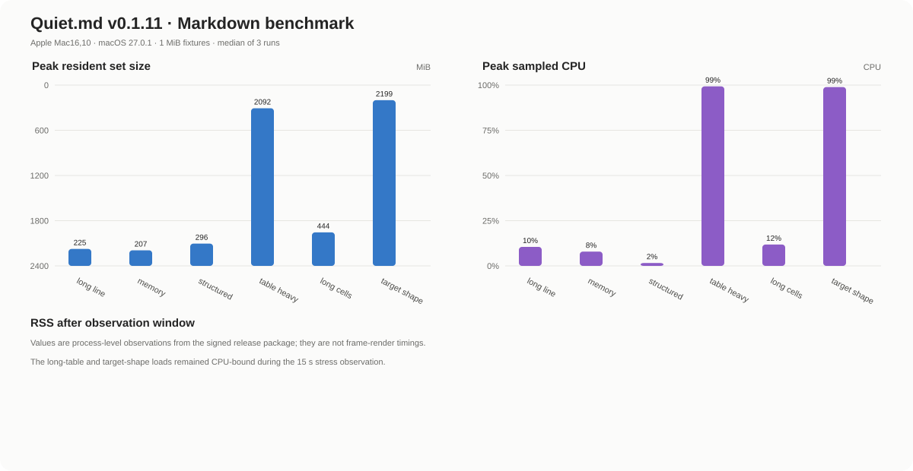

# Quiet.md performance data

This benchmark records the installed Quiet.md release package and keeps the product version with every result so later releases can be compared.

## Build identity

| Field | Value |
| --- | --- |
| Product | Quiet.md |
| Version | `v0.1.11` |
| Source revision | `d826d6eb91f6898d3fc66eca793f3088bdd76b14` |
| Package | macOS arm64 release package |
| Machine | Apple Mac16,10 (Apple Silicon), 24 GiB |
| OS | macOS 27.0.1 |
| Fixture set | 6 Markdown documents, approximately 1 MiB each |
| Repetitions | 3 independent processes per fixture |

## Process-level results

The release binary was started with each fixture as a command-line input and an isolated `QUIET_MD_HOME` library. RSS and CPU were sampled every 250 ms for approximately 3.7 s. “Peak RSS” and “Peak CPU” are the median and P95 over the three runs; “RSS at end” is the resident set at the end of that observation window. The 90% column is the median time to reach 90% of that run’s peak RSS.

| Fixture | Peak RSS median / P95 (MiB) | RSS at end median / P95 (MiB) | Peak CPU median / P95 | 90% peak RSS (ms) |
| --- | ---: | ---: | ---: | ---: |
| `long-line-1m.md` | 225.02 / 266.64 | 224.22 / 266.56 | 10.5% / 13.4% | 266.8 |
| `memory-heavy-1m.md` | 206.69 / 230.34 | 206.69 / 211.04 | 7.9% / 42.0% | 266.8 |
| `structured-1m.md` | 295.66 / 295.79 | 295.66 / 295.79 | 1.6% / 5.4% | 266.8 |
| `table-heavy-1m.md` | 2092.22 / 2128.62 | 2092.22 / 2119.10 | 99.3% / 99.9% | 1047.2 |
| `table-long-cells-1m.md` | 444.28 / 1966.30 | 443.53 / 1955.42 | 11.8% / 79.4% | 523.8 |
| `target-shape-12x1m.md` | 2199.03 / 2255.68 | 2188.33 / 2244.86 | 98.9% / 100.0% | 1055.6 |

## Stress observations

The following two loads were also observed for approximately 15 s. They remained CPU-bound throughout the extended window, so their RSS values must be read as an in-progress stress observation rather than a settled steady-state value.

| Fixture | Runs | Peak RSS (MiB) | RSS at 15 s (MiB) | Peak CPU | CPU at 15 s |
| --- | ---: | ---: | ---: | ---: | ---: |
| `table-heavy-1m.md` | 3 | 2406–2406 | 2395–2406 | 98.4–99.1% | 97.8–100.0% |
| `target-shape-12x1m.md` | 3 | 2199–2199 | 2188–2189 | 98.1–100.0% | 99.0–100.0% |

## Measurement boundary

Quiet.md’s official `bench` harness measures editor frame and render timings, but reproducing that path requires a source build with the `devtools` feature. This machine has CommandLineTools without the Metal shader compiler (`xcrun --find metal` fails), so no frame-time value is claimed here. The data above comes from the installed `v0.1.11` release binary and is directly reproducible from the raw JSONL file.

Raw per-run data: [`quiet-md-performance-data.jsonl`](quiet-md-performance-data.jsonl).
