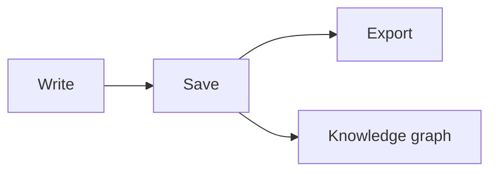

# Mory Writing Guide

Mory treats a **local folder** as your workspace, and every note is a plain Markdown file. Edit the rendered page directly, or press `⌘/` to switch to source mode.

## This week

- [x] Clean up highlights in [[Reading-Notes]]
- [x] Add numbers to the [[Weekly-Report]]
- [ ] Collect new ideas in [[Idea-Inbox]]

## Progress

| Module | Status | Owner |
| --- | --- | --- |
| Editor core | Done | Shared web |
| macOS host | Done | Swift |
| Windows host | In progress | Go + Wails |

## Code snippet

```ts
export function greet(name: string): string {
  return `Hello, ${name}!`;
}
```

## Flow



> Capture everything in Markdown and turn scattered notes into searchable, linkable memory.
