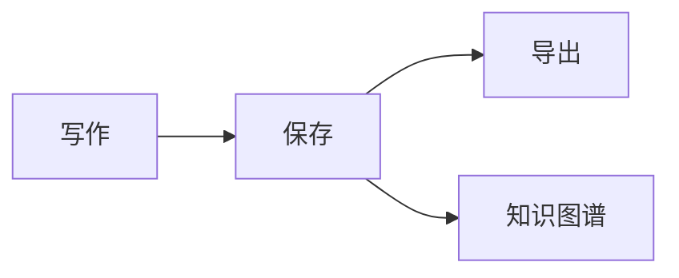

# Mory 写作指南

Mory 把**本地文件夹**当作工作区，所有文稿都是普通的 Markdown 文件。你可以直接在排版后的内容上编辑，也可以按 `⌘/` 切换到源代码模式。

## 本周计划

- [x] 整理 [[读书笔记]] 里的摘录
- [x] 为 [[项目周报]] 补充数据
- [ ] 把灵感收集到 [[灵感清单]]

## 进度一览

| 模块 | 状态 | 负责人 |
| --- | --- | --- |
| 编辑器内核 | 已完成 | 共享 Web |
| macOS 宿主 | 已完成 | Swift |
| Windows 宿主 | 进行中 | Go + Wails |

## 代码片段

```ts
export function greet(name: string): string {
  return `你好，${name}！`;
}
```

## 流程图



> 用 Markdown 记录内容，把分散的文稿组织成可检索、可引用的个人记忆。
